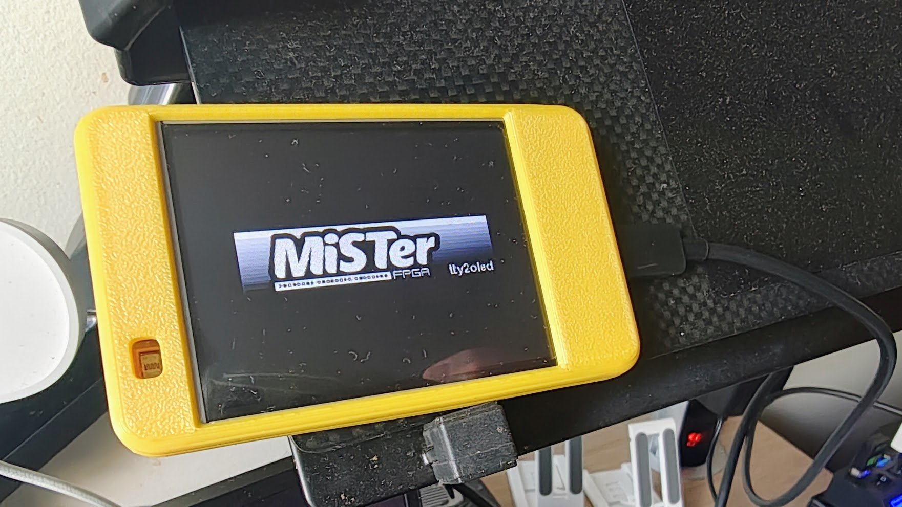
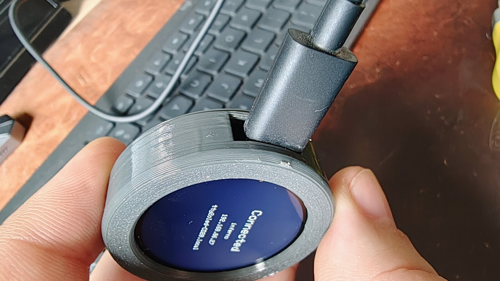
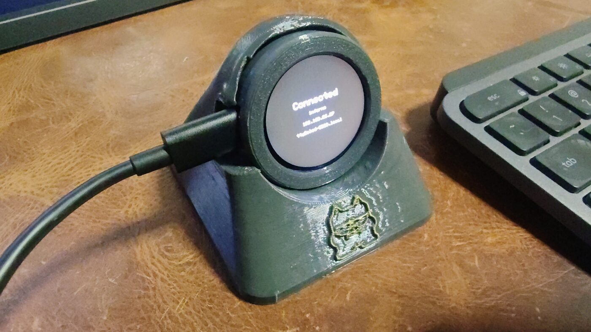
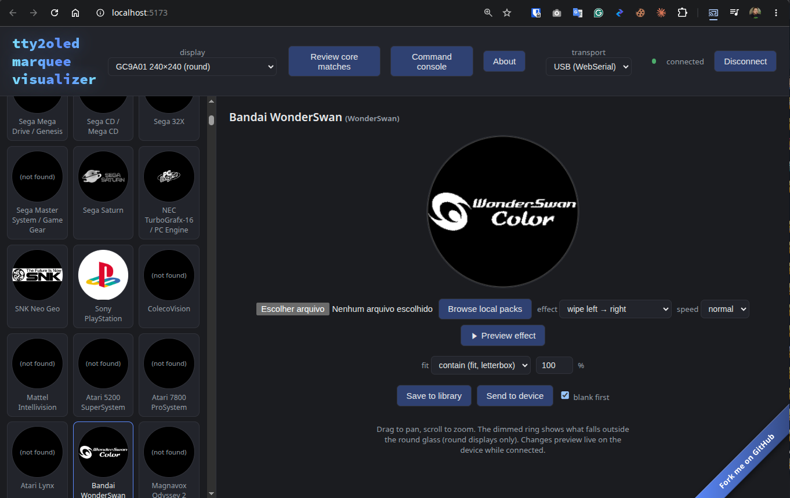

# mister-tty2oled-esp32
**[⚡ Flash the firmware](https://doccaz.github.io/mister-tty2oled-esp32/)** ·
**[🎨 Open the marquee web app](https://doccaz.github.io/mister-tty2oled-esp32/app/)** ·
[Releases](https://github.com/doccaz/mister-tty2oled-esp32/releases) ·
[Build from source](#build--flash-the-firmware)

<p align="center">
  
</p>

**Turn an ESP32 and a colour screen into a full-colour MiSTer marquee.** (An ESP32-C3 with a round GC9A01, the Sunton all-in-one, or the 2.8" "Cheap Yellow Display".)
Flash it straight from the browser, no tools to install. USB or WiFi, full-colour
art, and it works with the stock tty2oled.

An ESP32-C3 + GC9A01 (240×240 round SPI display) reimplementation of
[venice1200/MiSTer_tty2oled](https://github.com/venice1200/MiSTer_tty2oled) —
a physical marquee/status display for a [MiSTer FPGA](https://github.com/MiSTer-devel/Main_MiSTer/wiki)
that shows per-core artwork on a small screen.

It's **protocol-compatible** with the original: an unmodified
`tty2oled.sh` daemon on a real MiSTer talks to this firmware exactly as it
would to the original SSD1322-based hardware over USB serial (handshake,
contrast/rotation commands, and the legacy fixed-size grayscale picture
transfer all work unchanged). On top of that, it adds full-color JPEG
marquee art suited to the round display, a standalone web app for
building and previewing that art, WiFi (its own access point + a small
setup portal, no cable required to get it onto your network), the same
command protocol reachable over WiFi via WebSocket, and MQTT
notifications so things like Home Assistant can push text/image alerts
to the display.

## Get started

Everything runs in the browser (Chrome, Edge or Opera on a desktop, since
both use WebSerial):

| | What it does |
|---|---|
| **[⚡ Web flasher](https://doccaz.github.io/mister-tty2oled-esp32/)** | Installs the latest release on your board over USB. No toolchain. Hold BOOT while plugging the board in. |
| **[🎨 Marquee web app](https://doccaz.github.io/mister-tty2oled-esp32/app/)** | Build and manage the per-core art, preview it live on the display over USB. Back up your library from the header. |
| [Build from source](#build--flash-the-firmware) | PlatformIO, if you want to change the firmware. |

The two link to each other, so you can start with either. Details are in
[Flash from your browser](#flash-from-your-browser) and
[Run the web app](#run-the-web-app).

## In action

On a real MiSTer, running the unmodified `tty2oled.sh` over USB with the
Sunton ESP32-2424S012C as the display (opening a few autoboot console
cores):

https://github.com/user-attachments/assets/1d39b284-55ec-4096-ac44-fd0e79f9ddf0

([download the mp4](docs/mister-demo.mp4), 8 MB)

Full-color art (the extended `CMDCORC` command, sent by hand):

[](docs/color-marquee-full.jpg)

## What's in this repo

- **`firmware/`** — PlatformIO project for the ESP32-C3 boards and the
  classic-ESP32 "Cheap Yellow Display". Speaks the wire
  protocol below (over USB serial *and* WiFi), decodes JPEGs on-device,
  drives the GC9A01 (and, on the CYD, ILI9341) panel with a small hand-rolled SPI driver (see [Why a
  custom display driver](#why-a-custom-gc9a01-driver)), and optionally
  drives an onboard 0.42" status OLED.
- **`web/`** — a Vite + TypeScript single-page app. Lets you browse a
  library of per-core marquee art, crop/pan/zoom it to fit the round
  display, preview transition effects locally, and push it live to a
  connected device over [WebSerial](https://developer.mozilla.org/en-US/docs/Web/API/Web_Serial_API)
  (Chrome/Edge only) or WiFi (WebSocket).
- **`tools/`** — a small Python conversion pipeline that turns the
  community's legacy `.gsc`/`.xbm` marquee packs into PNGs for the web
  app's library browser.
- **`case/`** — a 3D-printable case for the Sunton ESP32-2424S012C (see
  [Case](#case-sunton-esp32-2424s012c)).
- **`reference/`** — the upstream `MiSTer_tty2oled` project, included as a
  git submodule. It's the protocol/format reference this firmware was
  built to be compatible with; nothing in it is built or copied into this
  project's own code.

## Hardware

Four boards are supported. All of them speak the same protocol and show the same
round-native 240×240 art (centred on the CYD's wider screen):

| Board | MCU | Display | Also on board | Build env | `CMDHWINF` id |
|---|---|---|---|---|---|
| [ESP32-C3 Super Mini](#discrete-build-esp32-c3-super-mini--gc9a01-module), with OLED | ESP32-C3 (RISC-V, native USB-CDC) | separate GC9A01 1.28" round, 240×240 | 0.42" SSD1306 status OLED, BOOT button | `esp32c3` | `HWGC9A01C` |
| ESP32-C3 Super Mini, no OLED | ESP32-C3 | separate GC9A01 module | BOOT button | `esp32c3_nooled` | `HWGC9A01C` |
| [Sunton ESP32-2424S012C](#all-in-one-board-sunton-esp32-2424s012c) | ESP32-C3 | 1.28" round GC9A01, soldered on | BOOT button, USB-C | `esp32c3_2424s012` | `HWGC9A01C` |
| [CYD ESP32-2432S028](#cheap-yellow-display-esp32-2432s028-cyd) | ESP32 (classic, dual core, CH340 USB-serial) | 2.8" 320×240 ILI9341 | resistive touch, light sensor, RGB LED, BOOT button, microSD slot (unused by the firmware) | `esp32_cyd` | `HWCYD28` |

The Super Mini is sold both with and without the built-in 0.42" OLED — the
firmware has a build-time flag for each variant (see
[Build & flash](#build--flash-the-firmware)). The pin tables below are board-specific.

### Reference build: Super Mini + GC9A01 module

| Component | Detail |
|---|---|
| MCU | ESP32-C3-mini (RISC-V, WiFi, native USB-CDC) |
| Display | GC9A01 240×240 round SPI TFT |
| Status display (optional) | Onboard 0.42" SSD1306 OLED, 72×40 visible |
| Wake button | Onboard "BOOT" pushbutton (GPIO9), repurposed at runtime |

### Pins (Super Mini + GC9A01 module)

Edit `firmware/src/pins.h` to match your wiring — it's the single place
all display pins are defined. Verified working on real hardware:

| Signal | GPIO |
|---|---|
| SCLK | 4 |
| MOSI | 0 |
| CS | 7 |
| DC | 1 |
| RST | 10 |
| BL (backlight, PWM) | 3 |
| OLED SDA | 5 (fixed on boards with the onboard OLED) |
| OLED SCL | 6 (fixed on boards with the onboard OLED) |
| Wake button | 9 |

Avoid the C3's strapping pins (GPIO2, 8, 9 — GPIO9 is deliberately used
anyway for the wake button, safe post-boot) and whatever pins your
specific board's onboard peripherals use if you change these. The native
USB-Serial/JTAG peripheral is fixed to GPIO18/19 in hardware and is used
automatically by `Serial` — this is what both a real MiSTer and the web
app's WebSerial connection talk to; it's never wired manually. GPIO20/21
are left free for an optional hardware debug UART (see `protocol.cpp`'s
`DBG_ENABLED`).

### Discrete build: ESP32-C3 Super Mini + GC9A01 module

The reference setup behind the pin table above: an ESP32-C3 **Super Mini**
(the variant with the built-in 0.42" status OLED) wired by jumpers to a
separate GC9A01 round display module. Build it with the default
`pio run -e esp32c3 --target upload` (or `esp32c3_nooled` if your board has
no OLED).


The round display on its "Connected" screen after joining WiFi (the
network name and IP are blurred out in this photo; the `.local` hostname
is the device's mDNS name).


Close-up of the Super Mini: the onboard 0.42" OLED shows the status
dashboard (firmware version, core name, RX activity), and the back of the
GC9A01 module (marked `M128-240240-RGB-7-V1.0`, `IC:GC9A01`) shows the
jumper wiring from the pin table.

The same discrete build mounted in a 3D-printed case (the
[BambuHelper case](https://makerworld.com/en/models/3140798-bambuhelper-bambu-lab-printer-status-display-case#profileId-3546296)
from MakerWorld), cycling through a few core logos:

https://github.com/user-attachments/assets/8abdfe0f-2628-4fc1-9971-e4dd4e71f6bb

([download the mp4](docs/case-demo.mp4), 0.3 MB)

### All-in-one board: Sunton ESP32-2424S012C

Also supported, and the simplest option: the Sunton **ESP32-2424S012C** is
a 1.28" round GC9A01 240×240 IPS display with an ESP32-C3-MINI-1U built
onto the back of it, USB-C, a reset and a BOOT button, and a battery
connector. Nothing to wire. This variant has no capacitive touch (the
firmware doesn't use touch anyway) and no status OLED.


The display pins are fixed by the board, and there's no reset GPIO (the
panel reset is tied to the board's reset, so the driver uses the GC9A01
software reset instead). Verified working on real hardware:

| Signal | GPIO |
|---|---|
| SCLK | 6 |
| MOSI | 7 |
| CS | 10 |
| DC | 2 |
| RST | none (software reset) |
| BL (backlight, PWM) | 3 |
| Wake button | 9 (the BOOT button) |

Build it with `pio run -e esp32c3_2424s012 --target upload`. The pins are
selected by the `BOARD_2424S012` flag in `firmware/src/pins.h`.

Verified on real hardware with this board:

- Display init and the `CMDTEST` ring pattern render correctly.
- `CMDHWINF` replies `HWGC9A01C;<version>;`.
- Backlight PWM works: `CMDCON` at 128/64/16/0 visibly dims the screen
  and `CMDCON,255` restores it.
- A full-color `CMDCORC` JPEG transfer (4917 bytes, iris effect) over USB
  decodes and displays correctly, and the firmware acks it.

Not yet tested on this board: sending art through the web app's WebSerial
path (the `CMDCORC` check above used a script speaking the same protocol),
and the WiFi/MQTT features.

### Cheap Yellow Display: ESP32-2432S028 ("CYD")

Also supported: the 2.8" **ESP32-2432S028** "Cheap Yellow Display" (a classic ESP32 with a 320×240
ILI9341 screen, resistive touch, a light sensor and an RGB LED). Nothing to wire. It shows the same
round-native art as the other displays, centred on the wider screen. Flash it from the
[web flasher](https://doccaz.github.io/mister-tty2oled-esp32/) (pick the CYD entry; its USB-serial chip
resets it into download mode by itself, so there is no BOOT-button step), or build it with
`pio run -e esp32_cyd --target upload --upload-port /dev/ttyUSB0`. Its hardware id is `HWCYD28`.

[](docs/cyd-photo.jpg)

What is different from the other boards:

- **Transfer LED** (on by default; checkbox on `/settings`): the RGB LED is solid blue while a picture is being
  received, flashes green once when it arrives and cyan twice if the transfer failed. Serial, WiFi and MQTT
  transfers all use it. Red is never used: GPIO4 is shared with the panel reset.
- **Touch wakes the display** (a firm tap; it's a resistive screen) and, in setup mode, shows the join QR.
  The BOOT button works too. Touch cannot trigger the 10-second factory reset.
- **Auto brightness:** on the device's `/settings` page, tick "Follow the room light" to let the light sensor set the
  backlight between a darkest and a brightest limit. A brightness sent by the MiSTer overrides it until the next reboot.
- It keeps no decoded picture in RAM (the classic ESP32's WiFi stack needs ~80 KB of free heap to work at all);
  it stores the JPEG and decodes it for every transition step, so transitions are a little coarser (8 to 13
  steps) than on the C3 boards.

Pins (from the board's silkscreen and verified with a probe on real hardware): display SCLK 14, MOSI 13,
MISO 12, CS 15, DC 2, backlight 21 (PWM), reset 4; touch CS 33, CLK 25, MOSI 32, MISO 39; light sensor 34;
BOOT 0. They are selected by the `BOARD_CYD` flag in `firmware/src/pins.h`.

Verified on real hardware with this board: pictures over USB and WiFi with every transition, the setup network and
saved-WiFi rejoin, backlight and auto brightness, touch wake, MQTT text and image notifications, and the
daemon driving it from a PC and from a real MiSTer (v0.6.0, together with two other displays; the Apple II logo
looked right on all three).

### Case (Sunton ESP32-2424S012C)



`case/` has a small two-part screw-together case for the all-in-one board:
`sunton_2424s012_case.scad` (parametric OpenSCAD) and the exported
`sunton_2424s012_front.stl` / `sunton_2424s012_back.stl`.

- **Front (cup):** the bezel with a round window, six small pads that centre
  the glass, a pocket for the PCB, an internal thread, a USB-C opening and a
  slot for the display's flex tail. Print it **face-down**.
- **Back (plug):** a flat disc the same diameter as the cup, with a hollow
  threaded skirt that screws in from behind (right-hand thread, 2 turns) and a
  coin slot underneath. Print it **flat, thread up**.
- Outer diameter about 45.5 mm, height about 13.7 mm. The USB-C window is sized
  for a molded cable plug (about 11.5 x 6.5 mm) with a little play.
- Print-tested on a real board; it fits and the glass has only slight play. The
  display can still float a little in depth, so a small foam pad behind the PCB
  helps. The back has an optional flat pedestal (`back_pedestal`, `ped_gap`) just
  below the board's tallest parts, so the board can only sag back about 0.3 mm and
  the foam pad can be thin. The owner reports the current values (`pcb_d` 38.2,
  `ped_gap` 0.3) fit the real hardware almost perfectly; if the plug won't seat
  on yours, raise `ped_gap` or set `back_pedestal = false`.

Tolerances depend on your printer. The ones you're most likely to tune are at
the top of the `.scad` file: `glass_clr` (side play around the glass, 0.35 mm
now; don't go much below 0.2), `thr_clr` (thread clearance), and
`usb_plug_w` / `usb_plug_h` (USB window). Set `tail_angle` and `usb_angle` to
match which side your flex tail and cable leave from. To regenerate the STLs:

```bash
openscad -o case/sunton_2424s012_front.stl -D 'part="front"' case/sunton_2424s012_case.scad
openscad -o case/sunton_2424s012_back.stl  -D 'part="back"'  case/sunton_2424s012_case.scad
```

**Desk stand.** `case/sunton_2424s012_stand.scad` (and its `.stl`) is a wedge-shaped
dock: a flat base with a round cradle leaning back 15 degrees. The case drops in
plug-side first and is held by a friction fit (`fit_clr`, 0.25 mm). Cable notches on
both sides let the USB cable leave left or right. Print it base-down, no supports.
The MiSTer-Kun mascot is embossed on the front (`logo` = `"mascot"`, `"text"` or
`"none"`); the artwork is credited in `case/mister_kun_CREDITS.txt`. The owner
printed it and reports it works well.



Both the case and this stand print from the `.scad`/`.stl` files in `case/` — no
supports, standard FDM.

```bash
openscad -o case/sunton_2424s012_stand.stl case/sunton_2424s012_stand.scad
```

### MiSTer daemon over WiFi

`mister/` holds `t2o-wifi`, a companion to the MiSTer's `tty2oled.sh` (it runs next to it, not instead of it) that sends the
current core's picture to the display over WiFi, so no USB cable is needed. It handles both the
community's legacy art packs (converted on the fly) and full-colour JPEGs. See
[`mister/README.md`](mister/README.md) for building and installing it.

**Keeping it updated.** The daemon is published as a
[MiSTer Downloader](https://github.com/MiSTer-devel/Downloader_MiSTer) database, so
`update_all` can keep it current alongside everything else. Add this once to the bottom of
`/media/fat/downloader.ini`:

```ini
[doccaz_mister_tty2oled_gc9a01]
db_url = https://doccaz.github.io/mister-tty2oled-esp32/t2o-wifi-db.json
```

Your `t2o-wifi.ini` (`HOST` and per-display settings) is shipped once but never overwritten,
so it survives updates. Or update on demand without touching `downloader.ini`: run
`t2o-wifi -update` (or the menu's **Check for updates**), which reads the same database,
verifies the download, and swaps the binary in place. See
[`mister/README.md`](mister/README.md#updating) for details.

## Flash from your browser

No toolchain needed: the **[web flasher](https://doccaz.github.io/mister-tty2oled-esp32/)**
writes the latest release to the board over USB (Chrome, Edge or Opera on
a desktop; it uses WebSerial and [ESP Web Tools](https://esphome.github.io/esp-web-tools/)).
For the ESP32-C3 boards, first hold BOOT while plugging the board in (the browser can't reset the
C3's native USB into download mode on its own; without this the page says
"Failed to initialize"), then pick your board, press "Connect and install"
and choose the serial port ("USB JTAG/serial debug unit"). The CYD needs no
BOOT step (its CH340 USB-serial chip resets it by itself); choose the CH340 /
"USB Serial" port. Flashing
keeps your saved WiFi and MQTT settings (the page writes the firmware's four
parts separately and never touches the settings area). The same site hosts the
[marquee web app](https://doccaz.github.io/mister-tty2oled-esp32/app/)
(the local art pack isn't included, it isn't redistributed).

With `esptool`, take the parts from the latest
[release](https://github.com/doccaz/mister-tty2oled-esp32/releases) and write
them at their own offsets, which also keeps your settings:

```bash
esptool.py --chip esp32c3 --port /dev/ttyACM0 write_flash \
  0x0     tty2oled-gc9a01-<ver>-bootloader.bin \
  0x8000  tty2oled-gc9a01-<ver>-partitions.bin \
  0xe000  tty2oled-gc9a01-<ver>-boot_app0.bin \
  0x10000 tty2oled-gc9a01-<ver>-<board>-app.bin   # board: esp32c3, esp32c3_nooled or esp32c3_2424s012
```

The CYD is a different chip (classic ESP32), so it has its own parts, with the bootloader at
`0x1000` instead of `0x0`:

```bash
esptool.py --chip esp32 --port /dev/ttyUSB0 write_flash \
  0x1000  tty2oled-ili9341-<ver>-bootloader.bin \
  0x8000  tty2oled-ili9341-<ver>-partitions.bin \
  0xe000  tty2oled-ili9341-<ver>-boot_app0.bin \
  0x10000 tty2oled-ili9341-<ver>-esp32_cyd-app.bin
```

The release also has one full-chip image per board (`…-<board>-full.bin` from
0.4.3 on, `…-<board>.bin` before). Those are for a brand-new device only:
they fill the space between partitions, so **writing one erases the saved
WiFi and MQTT settings** and the device returns to access-point setup.

## Build & flash the firmware

```bash
cd firmware
pio run -e esp32c3 --target upload          # default: includes the onboard OLED
pio run -e esp32c3_nooled --target upload   # board variant without the OLED
pio run -e esp32c3_2424s012 --target upload # Sunton ESP32-2424S012C all-in-one board
pio run -e esp32_cyd --target upload --upload-port /dev/ttyUSB0   # CYD ESP32-2432S028 (classic ESP32)
pio device monitor          # 115200 baud, watch for "ttyrdy;"
```

Requires [PlatformIO](https://platformio.org/) (CLI or the VS Code
extension). All dependencies (`JPEGDEC`, `Adafruit GFX Library`,
`ricmoo/QRCode`, `links2004/WebSockets`, `knolleary/PubSubClient`, plus
`U8g2` in the OLED variant) are pulled automatically via `platformio.ini`.

Maintainers: `tools/release.sh` builds the four variants, verifies them, tags
the commit, publishes the GitHub release and updates the web flasher with the
same images (see `CLAUDE.md`).

## First boot: WiFi setup

With no WiFi configured, the device starts its own open access point,
`tty2oled-XXXX` (last two bytes of its MAC address). Connect to it with
a phone or laptop — a captive-portal setup page should open
automatically, or browse to `http://192.168.4.1/`. It can scan for
nearby networks or you can type the SSID/password in by hand.

While in AP mode, pressing the wake button shows a scannable WiFi-join
QR code on the round display (encoding the open network's SSID) instead
of its normal screensaver-wake behavior.

Once configured, the device joins your network and is reachable at
`tty2oled-XXXX.local` (mDNS) — the round display's "Connected" screen
shows this hostname, along with the current IP. Visiting that address in
a browser shows a small status page with a "Forget WiFi" button (which
restarts the device back into AP mode) and, once configured, MQTT broker
settings (see [MQTT notifications](#mqtt-notifications) below).

If the saved network isn't available at power-up, the device tries it three
times before falling back to its own access point, and from the access point
it retries the saved network by itself every couple of minutes while nobody is
connected to it. `http://<device>/status` shows the signal strength
(`rssi`, in dBm; around -55 is good, below -75 is marginal).

## Device settings (v0.5.0)

Once the device is on your network, `http://tty2oled-XXXX.local/settings` has a
settings page: status (firmware, signal, time, free memory), brightness and
orientation defaults, an **idle clock** (show the time after X minutes idle,
optionally blank after a further Y minutes; any command or the BOOT button
brings the picture back), the status-OLED idle blank, **NTP** time with a
timezone list (or a custom POSIX TZ string), an optional admin password
(user `admin`) and **tint for monochrome pictures**: the MiSTer's black-and-white
marquees (and grayscale pictures from the web app) can be coloured with a fixed colour, a gradient, or a random colour
per picture. These are the defaults at power-up; a MiSTer's own
`CMDCON`/`CMDROT`/`CMDSAVER` commands override them until the next reboot.

## Run the web app

```bash
cd web
npm install
npm run dev                 # open in Chrome or Edge
```



Pick a display profile (round GC9A01, or a rectangular preview profile —
see [Display profiles](#display-profiles)), select a core, drop in an
image, pan/zoom to fit, and either let the live preview stream to a
connected device automatically or click "Send to device". "Save to
library" persists the art locally in the browser (IndexedDB) so it's
there next time.

The header's transport selector switches between **USB (WebSerial)** and
**WiFi** — for WiFi, enter the device's hostname (`tty2oled-XXXX.local`)
or IP address, then Connect. Both transports speak the identical command
protocol; the app doesn't care which one is active. The header also has
a **Command console** (documents and lets you exercise every command the
firmware understands) and an **About** panel with links back to this
project and the ones it's built on.

**Import folder** in the header loads art from a folder on your computer
and runs entirely in the browser (nothing is uploaded). It reads the
original tty2oled `.gsc` and `.xbm` files as well as PNG, JPEG, WebP and
GIF, matches names to cores (exact name, then the alternate spellings in
`web/src/aliases.ts`), and opens the "Review core matches" table so you can
check and save them. That's the way to use a pack you already have on the
hosted copy, which ships without the community art packs.
Big folders are fine (a full 1890-file pack imports in a few seconds): the
library shows 300 cores per category at a time with a **Show more** button,
and the filter box above it finds a core by name.

**Back up** and **Restore** in the header save your library (every core's
saved art) to a single JSON file and merge it back in. Browser storage is
per browser and per site, so it's worth backing up before clearing site
data or switching machines (this matters most on the hosted
`github.io` copy). Restoring never overwrites a core you've since edited:
a saved core is only replaced when the backup's copy is newer.

The hosted copy at `github.io` talks to the device over **USB only**: the
WiFi transport uses plain `ws://` (the ESP32 has no RAM to spare for TLS),
which browsers block from an `https://` page. Choosing WiFi there tells you
so instead of failing quietly. For WiFi, open the app over `http`: run it
locally (`npm run dev`, then `http://localhost:5173`) or serve a built copy
with any static server (e.g. `python3 -m http.server` in the app folder).

### Building the local marquee library

The editor's "Browse local packs" button needs a converted image index,
built from the community packs bundled in `reference/Pictures/ZIPs`
(pulled in via the `reference/` submodule):

```bash
git submodule update --init reference
tools/build_library.sh
# -> library/converted/<pack>/<name>.png + index.json
# -> synced into web/public/library/ for the web app to fetch
```

This step is optional and its output isn't tracked in this repo (see
[License](#license) — the bundled packs are third-party fan-made assets
of unclear licensing, kept local-only rather than redistributed). Cores
whose id matches a pack filename (or a known alias in
`web/src/aliases.ts`) auto-fill in the library grid once this is run.

## Wire protocol

115200 baud, line-based ASCII commands terminated by `\n`. The firmware
sends `ttyrdy;` once after boot, then `ttyack;` (no trailing newline)
after each processed command, unless `CMDSTTYACK,0` disables it — the
same handshake the original `tty2oled.sh` daemon expects.

**Commands compatible with the original protocol** (same behavior as
upstream, so an unmodified MiSTer daemon works unchanged):
`CMDCLS`/`cls`, `CMDCLSWU`, `CMDSORG`/`sorg`, `CMDCON,<0-255>`,
`CMDROT,<0|1>`, `CMDTXT,x,y,size,text`, `CMDGEO,type,x,y,w,h,fill`,
`CMDSNAM`, `CMDDOFF`, `CMDDON`, `CMDDUPD`, `CMDSECD,<ms>`, `CMDSHCD`,
`CMDSTTYACK,<0|1>`, `CMDRESET`, `CMDSAVER,<mode>,<interval>,<logotime>`
(parses the original's full grammar; implements simple blank-after-idle,
not its animated multi-screen screensaver), `CMDSWSAVER,<0|1>`, and a
bare line with no `CMD` prefix (legacy plain-corename fallback).

**Also implemented, new but original-protocol-shaped**: `CMDBYE`,
`CMDTEST`, `CMDSHSYSHW` (cosmetic/diagnostic screens built from
primitives, not the original's bitmap assets), `CMDHWINF` (replies
`HW<id>;<version>;`: `HWGC9A01C`, or `HWCYD28` on the CYD), `CMDCLST,<transition>,<color>` (solid-color
fill), `CMDSPIC[,<effect>]` (redisplay the last picture with a new
transition), `CMDSSCP` (redisplay at reduced size), `CMDSETTIME,<epoch>`
(sets the device clock; `tty2oled.sh` sends it at startup) and `CMDSHTIME`
(shows the clock as HH:MM plus date; not persisted across reboots).

**Legacy picture transfer**: `CMDCOR,<name>,<effect>` or `CMDAPD,...`
followed by a blocking, fixed-size read of exactly 2048 (1bpp XBM) or
8192 (4bpp grayscale "GSC") raw bytes, classified purely by byte count —
identical to upstream. Source images are 256×64; on the round display
they're scaled to fit (not cropped), since the safe display area is the
same 4:1 aspect ratio as the source.

**Full-color art**: `CMDCORC,<name>,<effect>,<durationMs>,<length>\n`
followed by exactly `<length>` raw JPEG bytes, length-prefixed (not
size-classified, so it isn't subject to the legacy path's fixed-size
truncation behavior). Decoded on-device and revealed with a transition
effect over `durationMs`. Effect ids (shared between firmware and web
app):

| id | effect |
|---|---|
| 0 | none (instant cut) |
| 1 | wipe left → right |
| 2 | wipe right → left |
| 3 | wipe top → bottom |
| 4 | iris (expand from center) |
| 5 | fade (cross-dissolve) |

### Over WiFi

The same command grammar is also reachable over a WebSocket on port 81
once the device has joined your network (see [First boot: WiFi
setup](#first-boot-wifi-setup)) — `ws://tty2oled-XXXX.local:81/`,
advertised via mDNS as `_ws._tcp`. `CMDCORC`'s JPEG payload is sent as a
text header frame followed by the image chunked into small binary
frames, rather than one big length-prefixed blob — this keeps every
allocation the device's WebSocket library needs to make small and
constant regardless of image size. Legacy `CMDCOR`/`CMDAPD` (raw
XBM/GSC) aren't supported over this transport — that grammar exists for
real-MiSTer-over-serial compatibility, and a WiFi client always has the
modern JPEG path available instead.

## MQTT notifications

Point the device at an MQTT broker (Home Assistant's built-in Mosquitto
add-on, or any other local broker) via the web status page's MQTT
section, and it'll show:

- A temporary text banner on any message published to `<prefix>/text`.
- A fetched image on any message published to `<prefix>/image` (the
  payload is a URL to a JPEG, not the image bytes themselves).

`<prefix>` defaults to `tty2oled/<device name>` and is configurable.
Both notification types show for a configurable duration (default 8s),
wake the display if the screensaver had blanked it, and then revert to
whatever marquee art was showing before them. Plain MQTT only (port
1883, no TLS) — suited to a local-network broker, not a cloud one.

## Display profiles

The web app's editor targets a selectable display profile
(`web/src/displays.ts`): the round GC9A01 this firmware drives, the
legacy 256×64 SSD1322 (real original hardware), and a couple of generic
rectangular sizes kept as preview/export targets for a possible future
firmware variant. Only the profiles with matching real firmware get a
live "Send to device" — GC9A01 sends `CMDCORC` JPEGs, the legacy SSD1322
profile sends `CMDCOR` grayscale GSC data; the generic rect profiles are
preview-only since no real hardware exists for them.

## Compatibility notes

This firmware was checked against the actual `tty2oled.sh` daemon script
(not just its documentation) to confirm real-world compatibility:

- The daemon never reads anything back from the device in its main
  loop — it just writes commands with fixed sleeps between them, so this
  firmware's `ttyack;` replies are harmlessly ignored, not required.
- **Upstream `installer.sh` knows this firmware.** `CMDHWINF` replies
  with the new hardware id `HWGC9A01C`. The installer used to treat an
  unrecognized `HW…` id as flashable and would claim "Flash progress
  completed" without flashing anything; since
  [venice1200/MiSTer_tty2oled#43](https://github.com/venice1200/MiSTer_tty2oled/pull/43)
  (merged 2026-10-13) it prints a short notice pointing here and exits.
  Update firmware with PlatformIO, not the MiSTer installer. **The CYD answers
  `HWCYD28`, which upstream's `installer.sh` does not know yet**, so with a CYD attached
  by USB the installer would behave the way it used to for any unrecognised id (claim
  success without flashing). Flash a CYD with the web flasher or PlatformIO, never with
  the MiSTer installer; an upstream notice for `HWCYD28` would be the same one-line change
  as the `HWGC9A01C` one.
- **Zaparoo's NFC reader probe.** Zaparoo's PN532 auto-detect opens every
  `/dev/ttyACM*` (including this display) after each core change and
  writes a PN532 wake-up preamble (`0x55 0x55 0x00 …`). An older build drew
  those bytes as a garbage corename right after each logo. The firmware now
  ignores any bare line containing control or non-ASCII bytes, so nothing
  needs changing on the MiSTer. If you'd rather stop the probing at the
  source, give the `pn532` entry in `/media/fat/zaparoo/config.toml` an
  explicit reader path instead of relying on `auto_detect`.

  **On the CYD this is required, not optional.** It is wired through a CH340
  on `/dev/ttyUSB*`, and a picture takes about 0.7 s at 115200 baud (a C3's
  USB-CDC finishes in milliseconds). Zaparoo reacts to a core change within
  about half a second, so its probe can land in the middle of a picture
  transfer. The logo then comes out sheared or shifted sideways (a few extra
  bytes pushed into the 8192-byte picture), and the same file may draw fine the
  next time. Seen on a MiSTer with `[readers] auto_detect = true`, with and
  without an NFC reader plugged in; the daemon was sending exactly 8192 correct
  bytes. The inserted bytes were not captured; the cause rests on the timing
  (Zaparoo's log shows a PN532 probe of the display's port inside the transfer
  window) and on the fix below, which made every picture clean.

  Fix: turn auto-detection off and connect the reader explicitly, so Zaparoo
  never opens the display's port. In `/media/fat/zaparoo/config.toml`:

  ```toml
  [readers]
  auto_detect = false

  [[readers.connect]]
  driver = 'pn532uart'
  path = '/dev/serial/by-path/platform-ffb40000.usb-usb-0:1.1:1.0-port0'
  ```

  then `/media/fat/Scripts/zaparoo.sh -service restart`. Verified on a real MiSTer
  with the CYD and a PN532 reader both plugged in: the reader connected and
  scanned a tag, Zaparoo's log showed no further probes of the display's port,
  and 12 rapid core changes all drew clean. With no NFC reader at all,
  `auto_detect = false` alone is enough. Zaparoo's docs have no per-port
  exclusion, only the global and per-driver `auto_detect`, so an explicit entry
  is the way to keep a reader and protect the display.

  **None of this applies over WiFi.** A display driven by the `t2o-wifi` daemon
  (see "MiSTer daemon over WiFi") gets its pictures over a WebSocket, not a
  serial port, and the daemon never opens a `/dev/tty*` device, so there is
  nothing for Zaparoo's probe to interfere with. This follows from how the
  transport works; the corruption was only ever seen on the wired path, and I
  didn't specifically test the WiFi path against an active probe.
- **Two USB-serial adapters: use `by-path`.** The CYD and many NFC readers are
  both CH340 (`1a86`) devices. They get `/dev/ttyUSB0`/`ttyUSB1` in whatever
  order they enumerate, so a replug or reboot can swap them, and then the stock
  daemon (`TTYDEV="/dev/ttyUSB0"`) sends pictures to the reader. A replugged port
  also loses the `stty` settings the daemon applied once at start-up (back to
  9600 baud) until the daemon restarts. `/dev/serial/by-id` can't help (identical
  ids, so only one link appears); `/dev/serial/by-path/platform-…-usb-0:1.2:1.0-port0`
  is distinct per physical USB port. Set `TTYDEV` in `tty2oled-system.ini` to it
  (list yours with `ls -l /dev/serial/by-path`) and restart the daemon
  (`/media/fat/tty2oled/S60tty2oled restart`); keep each device in the same port.
- Related Zaparoo issues: [#89 "Conflict with tty2oled"](https://github.com/ZaparooProject/zaparoo-core/issues/89)
  (closed; a maintainer said the cause was identified, no confirmed fix in the
  thread; the tty2oled author's workaround is in the
  [tty2oled wiki](https://github.com/venice1200/MiSTer_tty2oled/wiki/Troubleshooting)
  under "tapto recommendation") and
  [#99 "Launching cores causes UART reader to disconnect"](https://github.com/ZaparooProject/zaparoo-core/issues/99)
  (closed; also a tty2oled conflict). Zaparoo's reader options are documented at
  [zaparoo.org/docs/core/config/readers](https://zaparoo.org/docs/core/config/readers/).
- **Device path matters.** The ESP32-C3 boards use the chip's native
  USB-CDC peripheral, which Linux enumerates as `/dev/ttyACM*` — the
  original hardware used a CP2102/FTDI-style chip, enumerating as
  `/dev/ttyUSB*` (so does the CYD, through its CH340). Point `TTYDEV` at the right one in
  `tty2oled-system.ini`, and make sure `USBMODE="yes"` (otherwise the
  daemon only ever sends plain core names, no picture data).
- `CMDSETTIME`, which `tty2oled.sh` sends once at daemon startup, **is
  implemented** (since 2026-10-10; this note used to say it wasn't, and that it
  flashed as garbled "core name" text). The MiSTer sends its local time as epoch
  seconds already shifted by the timezone offset, and the firmware keeps it as
  the clock for the idle clock screen (`CMDSHTIME`). It isn't saved across
  power cycles (there's no battery-backed RTC), but the script re-sends it
  at every start, and once the device has synced with an NTP server (the default
  once it's on WiFi, see [Device settings](#device-settings-v050)) the NTP time wins
  and `CMDSETTIME` is ignored. `CMDSAVER` is implemented too, see [Wire
  protocol](#wire-protocol) above.

## Why a custom GC9A01 driver

Two existing Arduino display libraries were tried first and both had real
ESP32-C3 bugs, only discovered by flashing actual hardware:

1. **`moononournation/GFX Library for Arduino`** — its fast SPI databus
   references a hardware register (`DR_REG_SPI3_BASE`) that doesn't exist
   on the C3, pulled in unconditionally regardless of which databus class
   is actually used. Compile-time failure, never got as far as flashing.
2. **`TFT_eSPI`** — compiled and flashed cleanly, but hung the chip on
   every boot inside its ESP32-C3-specific SPI init path (task watchdog
   reset, confirmed via bisection with checkpoint logging, with the
   underlying SPI wiring separately proven fine via a bare `SPIClass`
   diagnostic sketch).

Given both, `firmware/src/gc9a01.h`/`.cpp` is a ~150-line direct driver
on top of plain Arduino `SPIClass` — manual CS/DC/RST toggling, the
GC9A01's standard vendor register-init sequence (adapted from
TFT_eSPI's MIT-licensed `GC9A01_Init.h` — reused as functional
hardware-bring-up data, not as library code), and a fast `pushRect()`
bulk blit for JPEG frames and transitions. It subclasses `Adafruit_GFX`
only for its software text/shape routines.

## Future implementations

These are directions, not commitments. Where something is partly built, it says so.

Already done and no longer on this list: running the display without a USB cable. The
[MiSTer daemon over WiFi](#mister-daemon-over-wifi) watches the same core-name file as
`tty2oled.sh`, sends the startup commands and every core change to up to three displays over
the WebSocket, converts legacy pictures to JPEG on the way, finds displays by name with its own
mDNS resolver, reconnects and replays the current core, and runs next to the stock daemon.

### Updating the firmware over WiFi

Today a new firmware needs a cable (the web flasher or PlatformIO). The hardware allows
more: the default 4 MB partition table already has two app slots, and the images fit with room
to spare, so an update could go to the idle slot and a failed upload would leave the running
firmware untouched. Not built; the design notes:

- The display has no TLS, so it can't download from GitHub itself; something on the LAN has
  to push the image (the MiSTer daemon's menu, or an upload page on the device).
- Pushing firmware is a powerful action, so it would need a gate: the admin password, or a
  short window after pressing the BOOT button (which is hard to reach inside some cases).
- Bulk HTTP from this device is known to stall on a marginal WiFi link, so receiving a
  ~700 KB image needs measuring on real hardware first. A crash-looping but valid image would
  still need a cable, and the first firmware with the receiver has to be flashed by cable.

### The public-domain art pack

The tooling to publish a downloadable pack of colour marquees is built and rehearsed but
nothing is published: a second, opt-in Downloader database installs it into
`/media/fat/t2o-wifi/art-pd/` (never into your own `art/`), and the daemon already looks
there after your own pictures and before the stock grayscale ones. It would contain only
pictures whose source logo is tagged public domain on Wikimedia Commons (about 77 of the
roughly 430 generated), with a bundled attributions file. What's missing is the decision to
publish it.

### CYD follow-ups

- **A settings screen on the touch display.** Touch currently only wakes the display; the settings
  live on the device's web page.
- **Art made for the wide screen.** The CYD shows the round-native 240×240 art centred on its
  320×240 panel. The art pipeline only renders the round version, so using the full width would
  mean a rectangular variant.
- **Upstream installer notice.** The CYD answers `HWCYD28`, which the upstream
  `MiSTer_tty2oled` `installer.sh` doesn't know yet (see [Compatibility notes](#compatibility-notes));
  a small upstream change like the one for `HWGC9A01C` would stop it misreporting a flash.

### Art for cores that have none

Cores with no picture just show their name. A device could fetch art on demand, but that needs a
public catalog to fetch from (none exists that's free to redistribute) and an on-device cache so a
core change doesn't pay a network round trip every time. Blocked on the catalog, not on the code.

### Known issue to chase

About 1 to 3% of picture sends over USB get no acknowledgement within a few seconds. It also
happens on v0.5.8, so it isn't new, and the cause isn't known.

## License

Copyright (C) 2026 Erico Mendonca.

The code in this repository (`firmware/`, `web/`, `tools/`) is licensed
under the [GNU General Public License, version 3](LICENSE) or, at your
option, any later version (`GPL-3.0-or-later`); each source file carries
an SPDX header saying so. It was MIT-licensed until the switch to GPLv3;
copies obtained under the earlier MIT terms remain MIT.

This is compatible with the GPLv3 license of the upstream
[`MiSTer_tty2oled`](https://github.com/venice1200/MiSTer_tty2oled) project
this firmware is protocol-compatible with. The firmware is still an
independent, from-scratch reimplementation of the same wire protocol, not a
copy of that codebase.

A few things are explicitly **not** covered by that grant:

- **`reference/`** is a git submodule pointing at the upstream project
  above, which is GPLv3-licensed under its own copyright. It's included
  purely as a protocol/format reference, and its contents remain under
  their original license.
- The GC9A01 register-init sequence in `firmware/src/gc9a01.cpp` is
  adapted from TFT_eSPI's MIT-licensed `GC9A01_Init.h` (see [Why a custom
  GC9A01 driver](#why-a-custom-gc9a01-driver)). MIT is compatible with
  GPLv3, and that code stays attributed to its original authors.
- The community marquee art packs referenced by `tools/build_library.sh`
  (fetched from `reference/Pictures/ZIPs` via the submodule above) are
  third-party fan-made assets of unclear/unverified licensing. They are
  **not** included in this repository — `library/converted/` and
  `web/public/library/` are build output, gitignored, and only ever
  generated locally on your own machine if you choose to run that
  script.
- Third-party libraries pulled in by PlatformIO and npm keep their own
  licenses.

## Acknowledgments

Built on the protocol and hardware design work of
[venice1200 and ojaksch](https://github.com/venice1200/MiSTer_tty2oled),
the original tty2oled project's authors. The onboard status OLED support
was ported from a [WLED usermod](https://github.com/wled/WLED/pull/5475)
for the same panel.

The embossed mascot on the case stand is MiSTer-Kun, created by HeWhoisRed and
remastered by baxysquare ([mister_kun](https://github.com/baxysquare/mister_kun));
see `case/mister_kun_CREDITS.txt`. It is not covered by this project's GPL grant.
