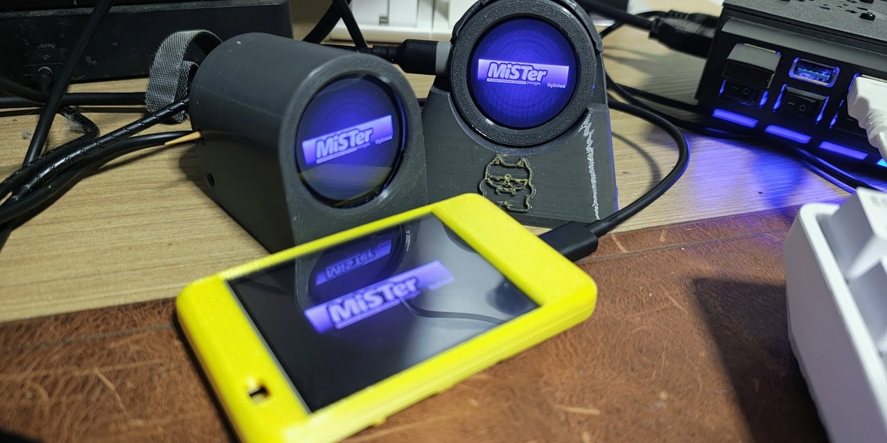

# mister-tty2oled-esp32

**[⚡ Flash the firmware](https://doccaz.github.io/mister-tty2oled-esp32/)** ·
**[🎨 Open the marquee web app](https://doccaz.github.io/mister-tty2oled-esp32/app/)** ·
[Releases](https://github.com/doccaz/mister-tty2oled-esp32/releases) ·
[Documentation](#documentation)

  

**Turn an ESP32 and a colour screen into a full-colour MiSTer marquee.** A
protocol-compatible re-implementation of
[venice1200/MiSTer_tty2oled](https://github.com/venice1200/MiSTer_tty2oled) for
cheap ESP32 boards: an ESP32-C3 with a round GC9A01, the Sunton all-in-one, or the 2.8" "Cheap Yellow Display".

- **Works with the stock tty2oled.** The unmodified `tty2oled.sh` on your MiSTer drives it over USB, and the existing grayscale logo library works as is (optionally tinted: fixed colour, gradient or random).
- **Full-colour art** with wipe, iris and fade transitions, built and previewed in a [browser app](docs/web-app.md).
- **USB or WiFi.** One MiSTer can drive up to three displays at the same time over WiFi, plus MQTT notifications for Home Assistant and friends.
- **Flash from the browser.** No tools to install; your WiFi settings survive updates.
- **A free colour art pack** (77 logos from public-domain sources) that installs through the MiSTer Downloader: [how](docs/mister-daemon.md#free-colour-art-pack).
- **3D-printable [cases](docs/case.md)** for the Sunton board.

## Get started

1. **Flash** your board from the [web flasher](https://doccaz.github.io/mister-tty2oled-esp32/) (Chrome, Edge or Opera on a desktop). Hold BOOT while plugging in a C3 board. Details in [Flashing](docs/flashing.md).
2. **Join WiFi** (optional): the display opens its own setup network and shows a QR code. See [First boot and settings](docs/setup.md).
3. **Drive it from your MiSTer:** plug it in over USB and the stock `tty2oled.sh` just works, or install the [WiFi daemon](docs/mister-daemon.md) to skip the cable.
4. **Make art** (optional) in the [marquee web app](https://doccaz.github.io/mister-tty2oled-esp32/app/).

## In action

[Watch the demo on YouTube](https://youtu.be/vCht3E33k4c): grayscale, gradient and random-colour logos, then full-colour art, on three displays driven at once from one MiSTer.

On a real MiSTer, running the unmodified `tty2oled.sh` over USB with the Sunton ESP32-2424S012C as the display (opening a few autoboot console cores):

https://github.com/user-attachments/assets/1d39b284-55ec-4096-ac44-fd0e79f9ddf0

## Supported boards

All of them speak the same protocol and show the same round-native 240×240 art (centred on the CYD's wider screen). Wiring, pins and per-board notes are in [Hardware](docs/hardware.md).

| Board | Display | Build env | `CMDHWINF` id |
|---|---|---|---|
| [ESP32-C3 Super Mini](docs/hardware.md#discrete-build-esp32-c3-super-mini--gc9a01-module), with onboard OLED | separate GC9A01 1.28" round | `esp32c3` | `HWGC9A01C` |
| ESP32-C3 Super Mini, no OLED | separate GC9A01 1.28" round | `esp32c3_nooled` | `HWGC9A01C` |
| [Sunton ESP32-2424S012C](docs/hardware.md#all-in-one-board-sunton-esp32-2424s012c) | 1.28" round GC9A01, soldered on | `esp32c3_2424s012` | `HWGC9A01C` |
| [CYD ESP32-2432S028](docs/hardware.md#cheap-yellow-display-esp32-2432s028-cyd) | 2.8" 320×240 ILI9341, touch | `esp32_cyd` | `HWCYD28` |

## Documentation

| | |
|---|---|
| [Hardware](docs/hardware.md) | boards, wiring and pins, onboard OLED |
| [Case](docs/case.md) | the 3D-printable case and desk stand |
| [Flashing](docs/flashing.md) | web flasher, esptool, building from source |
| [First boot, settings and MQTT](docs/setup.md) | WiFi setup, the settings page, notifications |
| [MiSTer daemon over WiFi](docs/mister-daemon.md) | driving up to three displays without a cable |
| [Marquee web app](docs/web-app.md) | building and previewing art, display profiles, the local library |
| [Wire protocol](docs/protocol.md) | commands over USB serial and WiFi |
| [Compatibility notes](docs/compatibility.md) | how it differs from the original, and why a custom display driver |
| [Roadmap](docs/roadmap.md) | what's planned and what's a known issue |
| [License details](docs/licensing.md) | what the GPL grant does and doesn't cover |

## What's in this repo

- **`firmware/`**: the PlatformIO project (ESP32-C3 boards and the classic-ESP32 CYD).
- **`web/`**: the Vite + TypeScript marquee web app.
- **`mister/`**: `t2o-wifi`, the MiSTer-side daemon (Go).
- **`tools/`**: the conversion pipeline and release scripts.
- **`case/`**: 3D-printable case files.
- **`reference/`**: the upstream `MiSTer_tty2oled` project as a git submodule, used as the protocol/format reference only.

## License

GPLv3 or later (`GPL-3.0-or-later`), copyright 2026 Erico Mendonca; see [LICENSE](LICENSE). The third-party art packs, the `reference/` submodule and some init data are not covered by that grant: see [License details](docs/licensing.md).

## Acknowledgments

Built on the protocol and hardware design work of
[venice1200 and ojaksch](https://github.com/venice1200/MiSTer_tty2oled),
the original tty2oled project's authors. The onboard status OLED support
was ported from a [WLED usermod](https://github.com/wled/WLED/pull/5475)
for the same panel.

The embossed mascot on the case stand is MiSTer-Kun, created by HeWhoisRed and
remastered by baxysquare ([mister_kun](https://github.com/baxysquare/mister_kun));
see `case/mister_kun_CREDITS.txt`. It is not covered by this project's GPL grant.
